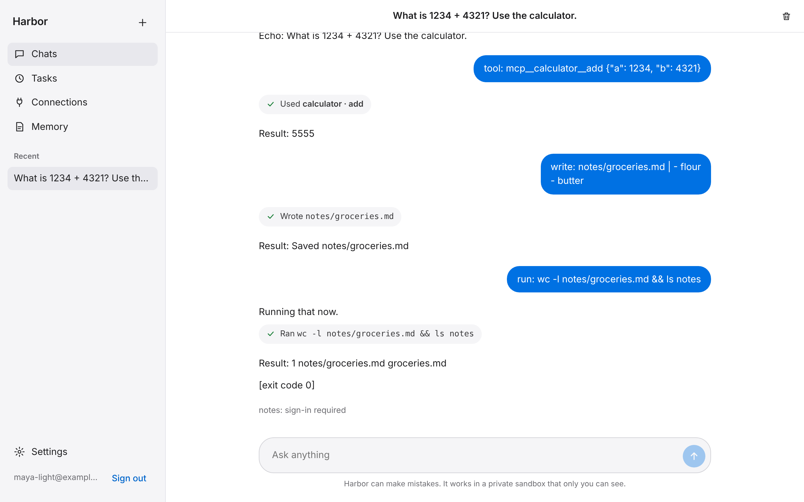
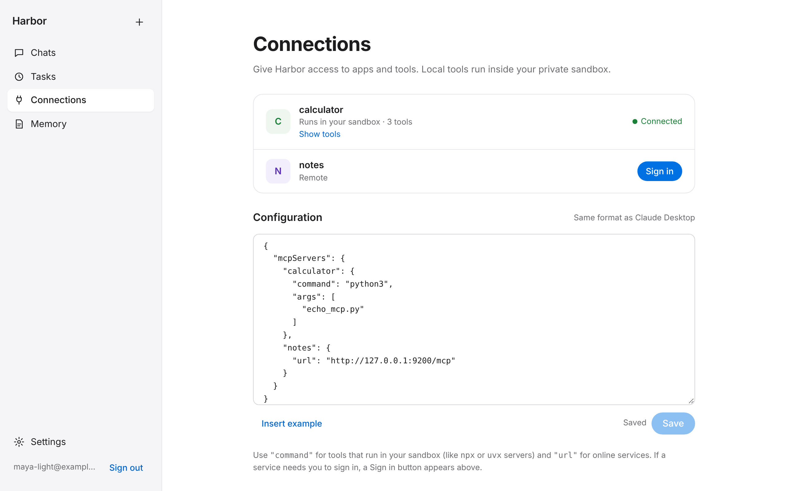
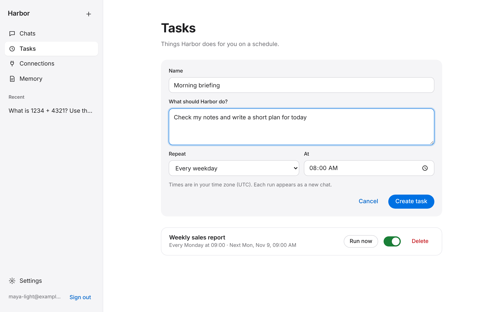
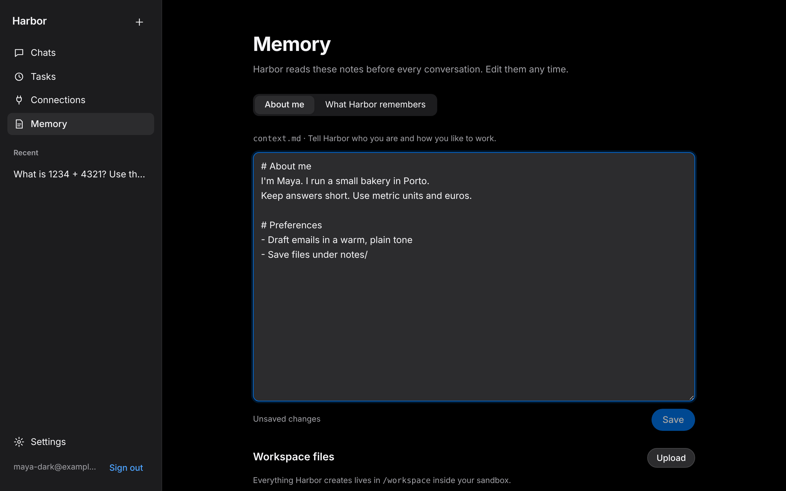

# Harbor

A simple, friendly AI agent for people who don't write code. Self-hosted. Each person gets their own
assistant with a private computer (a Docker sandbox), notes it remembers, connections to their apps,
and tasks that run on a schedule.

> This project was previously "AI Chatbot Framework" (intent/entity NLU chatbots). It has been rebuilt
> from scratch as an agent. The old code is in the git history before this rewrite.



## Features

- **Chat with tools** – Claude (default, via the Anthropic SDK) or any OpenAI-compatible server
  (OpenAI, Ollama, OpenRouter, vLLM, LiteLLM…). Tool calls show as small, expandable chips.
- **One private sandbox per user** – a Docker container with a persistent `/workspace`, no Linux
  capabilities, memory/CPU/process limits. The agent runs commands and scripts there.
- **Memory you can read and edit** – `context.md` (about you, your preferences) and `memory.md`
  (things you asked Harbor to remember) are injected into every conversation.
- **MCP connections** – paste a Claude-Desktop-style JSON config. Local servers (`npx`, `uvx`, …) run
  *inside your sandbox*; remote servers use Streamable HTTP with **OAuth sign-in** handled in the browser
  (PKCE, dynamic client registration, token refresh).
- **Recurring tasks** – "every weekday at 08:00, check my notes and write a plan". Each run becomes a chat.
- **Files** – upload files to your workspace; everything the agent creates is listed under Memory.
- Minimal, Apple-like UI with light and dark mode; works on phones.

| Connections | Tasks | Memory |
|---|---|---|
|  |  |  |

## Quick start (Docker)

Requirements: Docker with Compose.

```sh
git clone https://github.com/alfredfrancis/ai-chatbot-framework.git harbor && cd harbor
ANTHROPIC_API_KEY=sk-ant-... docker compose up --build
```

Open http://localhost:8000 and create an account. The first build also builds the sandbox image
(`harbor-sandbox:latest`, Python + Node + uv).

Harbor mounts the Docker socket so it can start a sandbox container per user. Anyone with access to
the Docker socket controls the host — run Harbor on a machine dedicated to it.

## Configuration

All settings are environment variables. Users can override the model settings in **Settings**.

| Variable | Default | Meaning |
|---|---|---|
| `HARBOR_LLM_PROVIDER` | `anthropic` | `anthropic` or `openai` (any OpenAI-compatible API) |
| `HARBOR_LLM_MODEL` | `claude-opus-5-5` / `gpt-4.1-mini` | Default model |
| `HARBOR_LLM_API_KEY` | `ANTHROPIC_API_KEY` / `OPENAI_API_KEY` | Server-wide key |
| `HARBOR_LLM_BASE_URL` | provider default | e.g. `http://localhost:11434/v1` for Ollama |
| `HARBOR_DATA_DIR` | `./data` | Database and user workspaces |
| `HARBOR_ALLOW_SIGNUP` | `true` | Set `false` after creating accounts (the first account can always sign up) |
| `HARBOR_COOKIE_SECURE` | `false` | Set `true` behind HTTPS |
| `HARBOR_SANDBOX` | `docker` | `docker`, or `local` for development (runs on the host, **not isolated**) |
| `HARBOR_SANDBOX_IMAGE` | `harbor-sandbox:latest` | Image for user sandboxes |
| `HARBOR_SANDBOX_NETWORK` | `bridge` | Docker network for sandboxes; `none` disables internet access |
| `HARBOR_SANDBOX_MEMORY` / `_CPUS` | `1g` / `1` | Limits per sandbox |
| `HARBOR_SANDBOX_HOST_DATA_DIR` | – | Host path of the data dir when Harbor itself runs in Docker |
| `HARBOR_COMMAND_TIMEOUT` | `120` | Seconds per command |
| `HARBOR_MAX_AGENT_STEPS` | `25` | Model calls per message |

### MCP configuration example

```json
{
  "mcpServers": {
    "filesystem": { "command": "npx", "args": ["-y", "@modelcontextprotocol/server-filesystem", "/workspace"] },
    "linear":     { "url": "https://mcp.linear.app/mcp" },
    "internal":   { "url": "https://mcp.example.com/mcp", "headers": { "X-Api-Key": "…" } },
    "github":     { "url": "https://api.example.com/mcp", "oauth": { "client_id": "…", "scopes": ["repo"] } }
  }
}
```

- `command` servers start inside the user's sandbox (`docker exec -i`), so they can only see `/workspace`.
- `url` servers that answer 401 show a **Sign in** button. Harbor discovers the authorization server
  (RFC 9728/8414) and registers itself (RFC 7591) unless you give an `oauth.client_id`.
- Add `"enabled": false` to switch a server off without deleting it.

## Development

```sh
make setup          # Python venv + npm install
make sandbox-image  # build harbor-sandbox:latest (or set HARBOR_SANDBOX=local)
make dev            # API on :8000, web app on :5173
```

Tests:

```sh
make test           # backend (pytest), Docker tests run when a daemon is available
make e2e            # Playwright end-to-end tests through the real UI
make e2e-docker     # the same with real Docker sandboxes (what CI runs)
make lint
```

Tests never call a real model: `backend/tests/fakes/` contains a scripted model server (speaks both the
Anthropic and OpenAI APIs), a dependency-free stdio MCP server and an OAuth-protected HTTP MCP server.

Read [AGENTS.md](AGENTS.md) before contributing — it describes the architecture, rules (every feature is
tested end to end, UI included) and design tokens. Claude Code users get `/feature`, `/verify` and
`/review-ui` commands from `.claude/commands/`. More detail in [docs/architecture.md](docs/architecture.md).

## Known limitations

- The model's reply arrives per step, not token by token.
- API keys and OAuth tokens are stored unencrypted in the SQLite database. Protect the data folder.
- Sandboxes run as root inside the container (no capabilities, `no-new-privileges`). For stronger
  isolation use a runtime like gVisor (`--runtime=runsc`) on the Docker host.
- One Harbor process; the scheduler is in-process, so don't run multiple replicas against one database.

## License

MIT, see [License.txt](License.txt).
