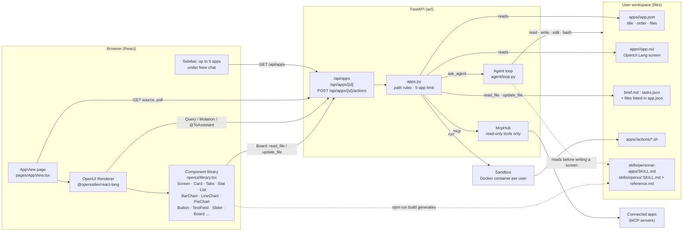
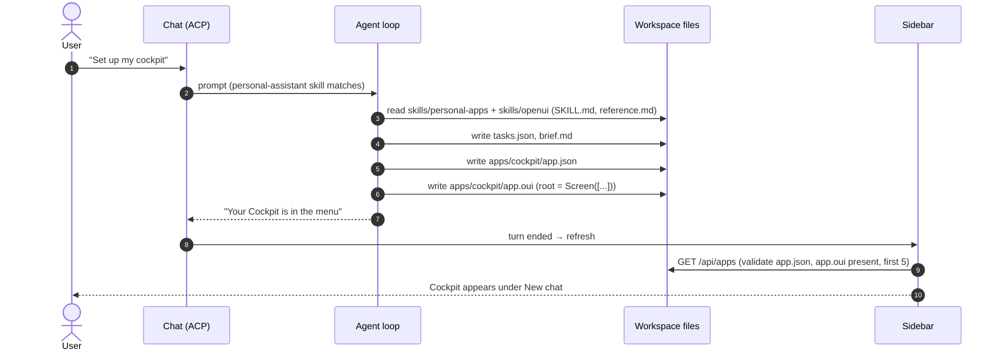
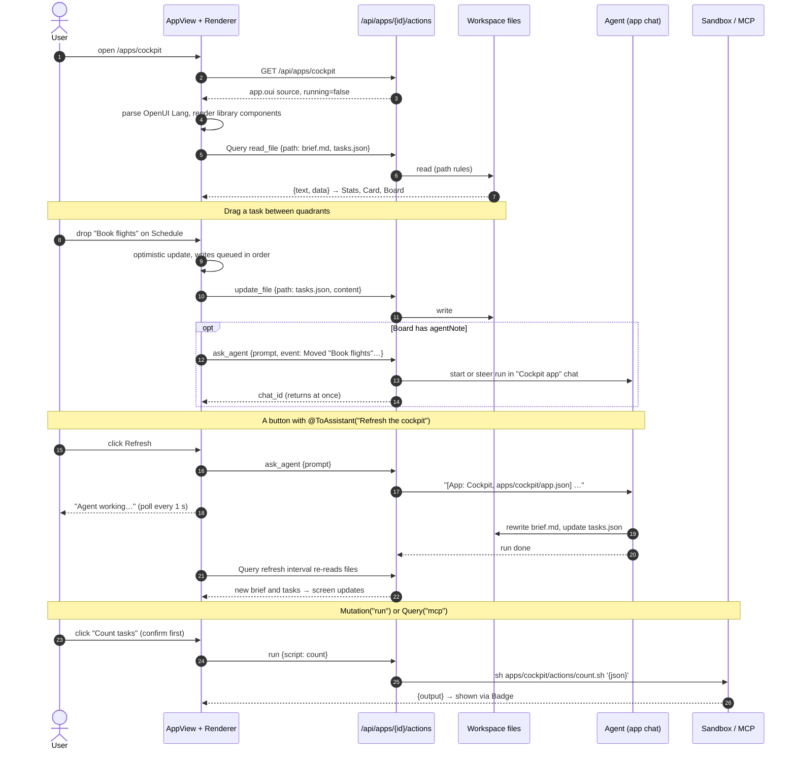

# Personal apps

An app is a folder of files in the user's workspace. The agent writes a screen in
[OpenUI Lang](https://openui.com); the web app renders it with design-system components
(`frontend/src/openui/library.tsx`); every click goes through one action API
(`POST /api/apps/{id}/actions`) back to those files, the agent, the sandbox or a connected app.
Implementation notes: [architecture.md](architecture.md#personal-apps-backendacfappspy-frontendsrcopenui).

## Architecture

- **No app backend.** State is the files in `apps/<id>/`; the API only enforces where an app may read and write.
- **No generated HTML.** `app.oui` can only name components from `openui/library.tsx`, which use the design
  system's classes and tokens.
- **One vocabulary, two readers.** The same library renders screens and generates the agent's reference
  (`builtin_skills/openui/reference.md`), so the agent can't use a component that doesn't exist. CI checks
  the file is current.
- **Path rules.** An app reads and writes its own folder (never `app.json` or `app.oui`) plus files listed in
  `app.json`.
- **Writes to other services go through the agent.** The `mcp` action refuses tools not marked read-only;
  `ask_agent` lets the agent ask the user first.

## Sequence: the agent creates an app

## Sequence: the user works in the app

- **Polling, not push.** The page polls the app (4 s, or 1 s while the agent works); `Query(…, refreshSeconds)`
  keeps data current.
- **Broken screens are fixable from the page.** Parse errors show in a banner with "Ask the agent to fix it",
  which sends the errors to the app chat.
